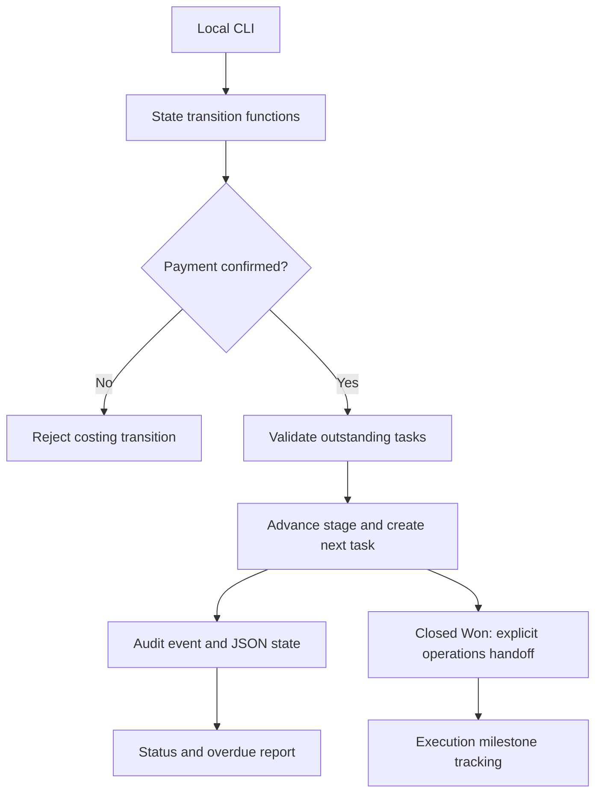

# Architecture

`pipeline.py` separates validation and domain functions from the CLI. Each case owns its stage, owner, tasks, payment reference and audit events. An explicit handoff starts Documentation → Supplier readiness → Production → Booking → Transit → Customs → Delivery → Closed; this is a separate execution state rather than extending the sales funnel. Each operational transition needs a human-supplied evidence reference and an owner/due date for the next milestone. The payment gate is evaluated when entering Cost Estimate Started; interest alone cannot unlock it. The local store uses an atomic replace to reduce partial-write risk, but is not safe for concurrent writers. Audit entries are not tamper-proof. Future work: validated import/export schema, role-based access, payment verification, multi-user database, document attachments and SLA dashboards. No production integrations or real customer records are included.
